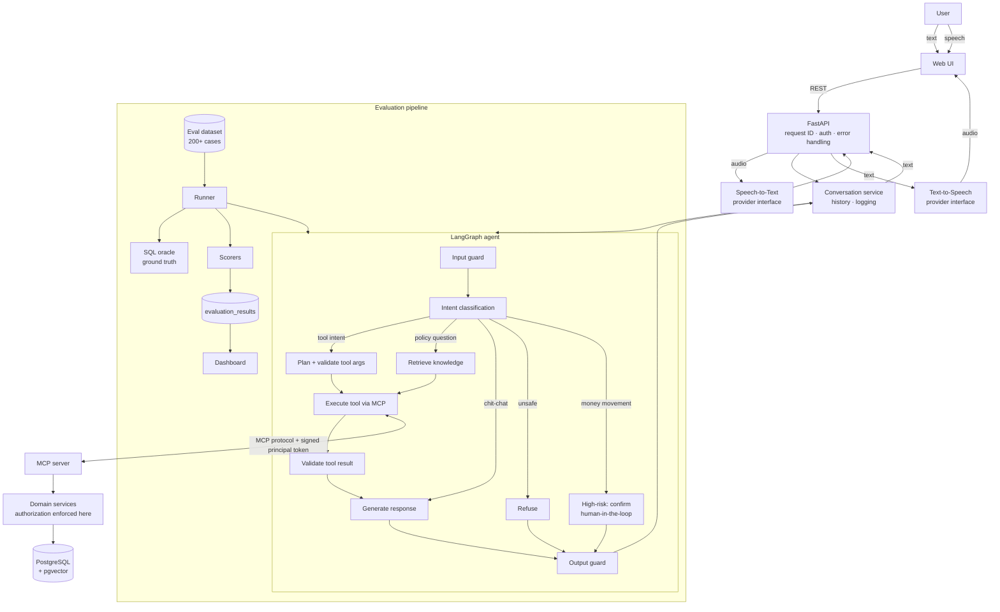
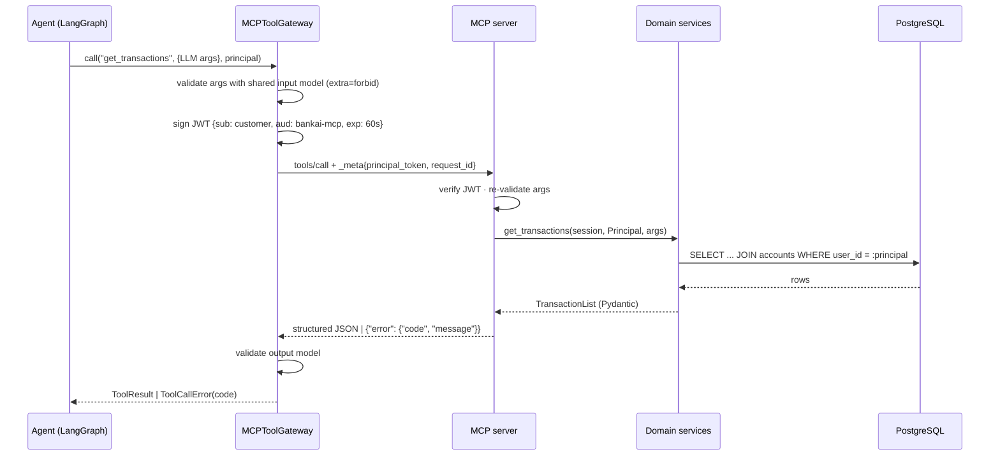

# BankAI — Architecture & Design Decisions

> Portfolio prototype. **All banking data is MOCK data.** No real customers,
> accounts, payments or credentials exist anywhere in this system, and no
> component is able to move money.

This document is the engineering design: what the components are, why they are
shaped this way, and what is still risky. The README (phase 13) summarises it.

---

## 1. System overview



### Request lifecycle (text)

1. **FastAPI** authenticates the (mock) user, assigns a `request_id`, validates the body.
2. **Conversation service** loads recent history and invokes the graph with typed state.
3. **Input guard** (deterministic rules) flags prompt injection, secret/credential
   requests, other-customer references and malformed input *before* any LLM call.
4. **Intent classification**: deterministic rules first; the LLM (structured JSON
   output) handles what rules cannot. Output is validated with Pydantic; invalid
   output falls back to rules or a clarification question.
5. **Routing** (LangGraph conditional edges) picks a branch.
6. **Tool execution** goes through **MCP**. The agent never imports the database.
7. **Result validation** checks the tool answered, in schema, with no error.
8. **Response generation** writes the answer *from the tool result / retrieved
   documents only*.
9. **Output guard** checks for leaked system prompt, secrets, other users' identifiers,
   and unsupported numbers (amounts/rates that appear in no tool result or document).
10. The turn is logged to `conversation_logs` (redacted) and returned.

---

## 2. Key design decisions

### D1. Identity never comes from the LLM
The LLM chooses *what* to look up (date range, category, amount), never *whose*
data. `user_id` comes from the authenticated session. When the agent calls an MCP
tool it attaches a short-lived signed token (JWT) for that user; the MCP server
verifies the token and the domain services check ownership of every account they
touch. A successful prompt injection can therefore at most make the agent ask for
the *current* user's data in an odd way — it cannot widen access.

### D2. Safety is defense in depth; authorization is the boundary
The input/output guards reduce risk and give good refusals, but rule- and
LLM-based detectors can be bypassed (encodings, paraphrases). That is acceptable
only because authorization is enforced independently in the tool layer (D1) and
because no tool can move money (D6). Tests attack each layer separately.

### D3. A deterministic offline mode
`LLM_PROVIDER=fake` swaps the OpenAI client for a deterministic provider
(rule-based intent classification, template responses, hashed bag-of-words
embeddings). Unit tests, integration tests, CI and a baseline evaluation run need
**no API key and cost nothing**. Real-LLM tests carry `@pytest.mark.llm` and run
separately. Every evaluation run records which provider/model produced it, so
offline numbers are never presented as LLM numbers.

### D4. MCP as the tool boundary
Tools live in a separate MCP server process with typed schemas. Benefits:
the agent depends on a protocol, not on database code; tools are reusable by any
MCP client; the server is the single place where tool inputs are validated and
authorization is enforced; it can be deployed, scaled and secured separately.

### D5. pgvector inside PostgreSQL
One database for relational data and embeddings: transactional consistency, one
backup, SQL filters combined with vector search, fewer moving parts. Unit tests
use an in-memory vector store behind the same interface.

### D6. High-risk actions use human-in-the-loop, and nothing executes them
"Transfer 5000 GEL" is classified as a high-risk action. The graph pauses
(LangGraph `interrupt`) and asks for explicit confirmation; on confirmation it
records a **MOCK transfer request** and says clearly that no money moved. There
is deliberately no tool with the capability to change a balance.

### D7. Data modelling for money
* `NUMERIC(14,2)` ↔ Python `Decimal` — never `float`.
* Amounts are positive; `direction` (debit/credit) carries the sign; CHECK constraints enforce it.
* Enums are `VARCHAR` + `CHECK` (not native PG enums) — easy to extend, still enforced by the DB.
* UUID primary keys — IDs cannot be guessed by incrementing.
* Naming convention for constraints so Alembic migrations stay deterministic.

### D8. Deterministic, self-consistent mock data
Seeded RNG + `uuid5` IDs ⇒ the same customers and IDs on every machine. Each
balance equals its ledger and never goes negative historically — this invariant
is tested in Python *and* in SQL.

### D9. Evaluation ground truth is computed, not typed in
Evaluation cases describe *what* the truth is ("restaurant spending of CUST-0003
this month"); an independent SQL **oracle** computes the expected value at run
time. Scores are computed per case, stored per run, and aggregated into the
report and dashboard. No metric is hard-coded.

---

## 3. Folder structure (target)

```
BankAI/
├── app/
│   ├── api/          FastAPI app factory, routers, request/response schemas, middleware
│   ├── agents/       LangGraph state, nodes, graph, intent router, prompts
│   ├── llm/          LLM provider interface: OpenAI + deterministic offline provider
│   ├── mcp/          MCP server + tool definitions; MCP client gateway used by the agent
│   ├── services/     Domain logic: accounts, transactions, spending, FX, calculator, authorization
│   ├── rag/          Chunking, embeddings, vector stores (pgvector / in-memory), retriever
│   ├── safety/       Input/output guards, policy rules, injection detectors
│   ├── voice/        stt.py, tts.py — provider interfaces, OpenAI + fake providers, audio checks
│   ├── evaluation/   Datasets (JSONL), runner, SQL oracle, scorers, report builder
│   ├── database/     Engine/session, declarative base, mock-data seeding
│   ├── models/       ORM entities and enums
│   └── core/         Config, structured logging, errors, token signing
├── alembic/          Database migrations
├── knowledge_base/   MOCK bank policy documents (Markdown) for RAG
├── frontend/         Static HTML/JS: chat, microphone, evaluation dashboard
├── scripts/          seed_db, ingest_knowledge_base, run_evaluation
├── tests/
│   ├── unit/         Fast, isolated (SQLite, fakes)
│   ├── integration/  Real PostgreSQL, MCP in-memory transport, API + DB
│   ├── safety/       Prompt-injection suite, data-leakage and authorization attacks
│   ├── evaluation/   Tests of the evaluation framework itself
│   └── voice/        STT/TTS providers, audio validation, error paths
├── docs/             Architecture and design notes
├── Dockerfile, docker-compose.yml
└── .github/workflows/ci.yml
```

`app/llm/` is an addition to the originally proposed layout: it isolates the
LLM vendor so the agent, RAG and evaluation code can run against either OpenAI
or the offline provider.

---

## 4. Development phases

| # | Phase | Main deliverables | Status |
|---|-------|-------------------|--------|
| 1 | Setup, config, database | Settings, JSON logging + redaction, ORM schema, Alembic, deterministic seed, tests | ✅ Done |
| 2 | Banking tools + MCP | Domain services, authorization, Pydantic tool schemas, MCP server, MCP client gateway, signed principal tokens | ✅ Done |
| 3 | LangGraph agent | Typed state, nodes, routing, LLM provider abstraction (OpenAI + offline) | ✅ Done |
| 4 | RAG | Knowledge base docs, chunking, embeddings, pgvector store, grounded answers with citations, "not enough information" path | ✅ Done |
| 5 | Safety + authorization | Guards, policy module, injection detectors, high-risk confirmation flow (interrupt) | Next |
| 6 | Evaluation | 200+ case dataset, SQL oracle, scorers, runner, reports, DB persistence | |
| 7 | Voice | STT/TTS interfaces, OpenAI + fake providers, audio validation, Georgian notes | |
| 8 | FastAPI | All endpoints, mock login, request-ID middleware, error handlers, OpenAPI docs | |
| 9 | Frontend | Chat, microphone, audio playback, evaluation dashboard | |
| 10 | Testing | Fill gaps: security suite, voice, end-to-end; ≥80% coverage | |
| 11 | Docker | Dockerfile, compose: backend, mcp-server, db (pgvector), migrate/seed job | |
| 12 | CI/CD | Lint → type-check → unit → integration (PG service) → coverage → image build | |
| 13 | Docs | README, architecture diagrams, INTERVIEW.md | |

Testing is not deferred to phase 10: every phase ships with its tests.

---

## 5. The MCP tool layer (phase 2)



| Tool | Reads | Notes |
|------|-------|-------|
| `get_account_balance` | accounts | totals per currency, never mixed |
| `get_account_details` | users, accounts | |
| `get_transactions` | transactions | period in bank time, newest first, max 100 |
| `search_transactions` | transactions | text (LIKE wildcards escaped), amount range, category |
| `analyze_spending` | transactions | SQL `GROUP BY`; excludes transfers and income |
| `get_exchange_rate` | static MOCK table | every quote labelled as not real market data |
| `calculate_loan_payment` | banking_products | rate and limits from the product table, never from the caller |
| `search_banking_policy` | knowledge_chunks (pgvector) | RAG: passages + "enough information?" verdict (section 7) |

**Contract.** One Pydantic input model and one output model per tool
(`app/mcp/schemas.py`). The server builds each tool's MCP signature from the input
model, so the published JSON schema, the server-side validation and the
client-side validation can never drift apart.

**Error codes** (stable; the agent maps them to replies): `unauthenticated`,
`access_denied`, `invalid_arguments`, `rule_violation`, `not_found`,
`unavailable` (retryable), `timeout` (retryable), `unknown_tool`,
`invalid_tool_output`, `internal_error`, `tool_error`. Messages never contain stack
traces, SQL or the rejected input values.

**Transport.** Streamable HTTP, stateless, JSON responses, Host-header allow-list.
Tests use the same server in-process through the real MCP client.

**Known limitations (honest notes)**
* Undeclared arguments sent *directly* to the server (bypassing our gateway) are
  dropped by the MCP SDK before our code sees them. They cannot influence the call
  (proven by tests), but the server cannot log them. The gateway rejects them loudly.
* HS256 with a shared secret suits two services we operate. Third-party MCP clients
  would need asymmetric keys or the OAuth 2.1 flow from the MCP authorization spec.
* A new MCP client session is opened per call. Simple and stateless; connection
  reuse is an optimisation for later.
* Read-only is enforced by design and tests; a read-only database role for the MCP
  server (phase 11) would make it a database-level guarantee.

---

## 6. The LangGraph agent (phase 3)

The graph (generated from code: [agent_graph.md](agent_graph.md)):
`validate_input → classify_intent → call_tool → validate_tool_result → generate_response → finalize`,
with branches to `clarify`, `knowledge`, `general_response`, `refuse` and `high_risk_action`.
Typed state: `app/agents/state.py`. Entry point: `BankingAssistant.respond()` → `AssistantReply`.

**Two modes, one graph**

| | `LLM_PROVIDER=none` (offline) | `LLM_PROVIDER=openai_compatible` (Ollama / OpenAI) |
|---|---|---|
| Routing | deterministic rules only | rules first; the LLM for unclear or incomplete requests |
| Answers | deterministic templates | LLM phrasing, accepted only if it passes both guards |
| Used by | unit/integration tests, CI | local demo (qwen2.5:3b), live tests (`pytest -m llm`) |

**Routing** (`rules.py`, `router.py`): safety patterns (injection, other customers' data,
credentials, money movement) are matched first and the LLM can never override them.
A confident *and complete* rule match is final; anything else goes to the LLM, whose JSON
is validated with Pydantic, filtered to the tool's declared fields and then re-validated
field by field (`prepare_arguments`) - an invalid value is dropped, a missing one triggers
a clarifying question instead of a guess.

**Answer guards** (`grounding.py`, `rendering.py`): every tool result is rendered into
FACTS plus a correct-by-construction template answer. An LLM answer is replaced by the
template when it
1. contains a number that is not in the facts or the question (*no invention*), or
2. omits one of the result's key numbers (*no omission*), or
3. is empty, times out, or the LLM is unreachable.

Lists (transactions, accounts) are always shown as rendered. Refusals, errors and
clarifications are fixed texts, never generated.

**Found by live testing with a real model** (and now covered by regression tests):
follow-up detection hijacked unrelated messages; a 3B model dropped accounts from a
balance answer; a rendered fact ("100% of spending" for a single category) misled the
model. Each became a code fix plus a test.

**Known limitations**
* The guards check numbers only. A fluent, number-free false statement is not caught
  here - phase 5 (output guard) and phase 6 (groundedness evaluation) address that.
* Rules and templates are English. Georgian input is detected and handled only by the
  LLM, and a 3B local model is weak in Georgian.
* Local latency is 1-9 s per LLM call on an M4 laptop; offline answers take ~10 ms.

---

## 7. RAG over the knowledge base (phase 4)

```
question -> embed (search_query: ...) -> pgvector ORDER BY embedding <=> q LIMIT k -> enough? -> LLM (passages only) -> + sources
                                                                                     `- no ---> "not in the bank's documents"
```

* **Documents** - 11 MOCK policy documents in `knowledge_base/` (cards, transfers,
  international transfers, fees, exchange rates, loans, mortgages, savings, security,
  account management, payment limits). Rates and limits are tested against the product
  table, so the calculator (table) and RAG (documents) can never disagree.
* **Chunking** - one chunk per `##` section (52 chunks); sections are written to stand
  alone. Each chunk is embedded as "Title - Section: text".
* **Embeddings** - `nomic-embed-text` via Ollama (768 dims, with its `search_query:` /
  `search_document:` prefixes), or the offline `hashing` embedder (lexical baseline)
  for tests and CI. Every stored vector is tagged with its embedder; spaces never mix.
* **Store** - pgvector table `knowledge_chunks` with an HNSW cosine index (migration 0002);
  an in-memory store implements the same interface. Indexing is idempotent (content hashes).
* **The "enough information?" decision** - (1) top similarity must reach a calibrated
  threshold; (2) named things in the question (acronyms, codes, quoted names - "service
  XYZ") must occur in the documents; (3) passages scoring more than 0.12 below the best are
  dropped. Otherwise the agent answers "I couldn't find that in the bank's documents" and
  the LLM is not called.
* **Answering** - the LLM sees only the passages, must copy numbers exactly and must use a
  fixed sentence when the passages don't answer. The numeric grounding guard applies.
  Sources are appended **by code** from the retrieved passages, so they cannot be invented.

**Calibration** (`python -m scripts.calibrate_rag`, 16 in-scope / 6 out-of-scope questions):

| Embedder | right document in top 2 | lowest in-scope | highest out-of-scope | threshold |
|---|---|---|---|---|
| nomic-embed-text (prefixes) | 16/16 | 0.733 | 0.627 | 0.68 |
| hashing-v1-768 (offline) | 16/16 | 0.267 | 0.244 | 0.255 |

**Limitations** - 22 calibration questions are a small sample (phase 6 measures more);
the hashing margin is thin; out-of-scope questions phrased like banking questions ("buy
stocks through the app") score close to the threshold; citations list every passage the LLM
saw, not only the ones it used; a cold start loads models into memory (~20 s once).

---

## 8. Technical risks

| Risk | Impact | Mitigation |
|------|--------|-----------|
| Library churn: `mcp` 2.x, `openai` 3.x, `langgraph` 1.x and SQLAlchemy 2.1 are newer than most tutorials | Wrong API usage | Exact pins; verify APIs against installed source; integration tests per boundary |
| LLM non-determinism | Flaky tests, noisy metrics | Offline provider for CI; temperature 0 + structured outputs; repeated runs for LLM-mode eval |
| Detectors are bypassable (encoding, paraphrase, indirect injection) | Unsafe answers | Defense in depth (D2); authorization in the tool layer; adversarial test suite |
| Hallucinated fees/rates/amounts | Wrong financial info | Answers only from tool results/documents; numeric-claim verification against context; "not enough information" path |
| Georgian STT/TTS quality | Poor voice UX in Georgian | Document limitations; language hint; text fallback; evaluate on transcript-style inputs |
| pgvector not in the local Homebrew PostgreSQL 15 | Phase 4 blocked locally | **Resolved:** pgvector 0.8.6 built from source for PG15; Docker uses `pgvector/pgvector:pg16` |
| Docker not installed on the development machine | Phase 11 not verifiable locally | Install Docker Desktop / OrbStack; CI builds the image regardless |
| SQLite (unit) vs PostgreSQL (prod) differences | Bugs hidden in unit tests | PostgreSQL integration tests in CI (`REQUIRE_INTEGRATION_DB=1`) |
| Evaluation cost/latency with a real LLM | Expensive runs | Small default model, offline baseline, run subsets by category |
| "This month" depends on time zone and seed date | Off-by-one-day answers | Bank time zone (UTC+4) for periods; seed `--anchor`; oracle uses the same period logic |
