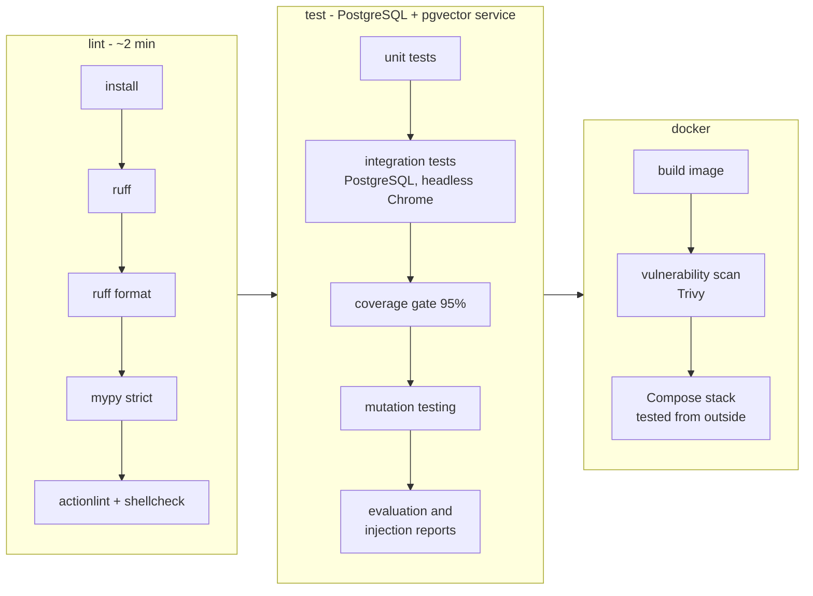

# Continuous integration

Every push and every pull request to `main` runs the pipeline in
[`.github/workflows/ci.yml`](../.github/workflows/ci.yml). It needs **no secrets and no API
key**: the agent runs offline (rules + templates), and everything else it needs (PostgreSQL,
Chrome, Docker) is part of the job.



This is the pipeline of the project specification (install → lint → unit tests → integration
tests → coverage → Docker image), with a few additions from the testing phase:

| stage | what fails the build |
|---|---|
| lint | a ruff finding, unformatted code, a mypy error (strict), a problem in a workflow file or in a shell script inside one |
| unit tests | any failing test (1,400+, no services needed) |
| integration tests | a failing test against PostgreSQL + pgvector or in headless Chrome |
| coverage | branch coverage of `app/` and `scripts/` below **95%** |
| mutation testing | a deliberate bug in a defence that no test notices (33 mutants) |
| reports | an attack that gets through, or another customer's data in any evaluation answer |
| docker | the image does not build; a **fixable** HIGH/CRITICAL vulnerability; the Compose stack fails its tests |

The evaluation report and the coverage total appear on the run's summary page. The reports
(`evaluation.md/json`, `prompt-injection.json`, `coverage.xml`) are kept for 30 days as an artifact.

## Rules the pipeline keeps

- **No silent skips.** Tests that need a service skip when it is missing on a laptop, but the
  workflow sets `REQUIRE_INTEGRATION_DB`, `REQUIRE_BROWSER`, `REQUIRE_DOCKER` (and in the
  live-models workflow `REQUIRE_LLM`, `REQUIRE_VOICE`). A missing database, browser or model
  makes the build **fail**, so a green build never hides tests that did not run.
- **Every test marker runs somewhere.** A test checks that the `-m` selections of the workflows
  cover every marker in `pyproject.toml`. A new marker that no job selects fails the build.
- **Pinned actions.** Every action is pinned to a full commit SHA, with the version as a comment.
  A tag like `@v7` can be moved to different code; a SHA cannot (the supply-chain attacks on
  popular actions worked through moved tags).
- **Least privilege.** The workflows only read the repository (`permissions: contents: read`) and
  use no secrets.
- **Cancel outdated runs.** A new push to a branch cancels its run that is still going.

These rules are tested in `tests/unit/test_ci_workflow.py`, and mutation testing breaks three of
them on purpose (an unpinned action, write permissions, a database lane allowed to skip). So the
pipeline's own configuration is covered like code.

## Image vulnerabilities

Trivy scans the built image. The gate fails only on HIGH or CRITICAL findings **that have a fix**:
nobody can act on an unfixed CVE in the Debian base image until Debian ships a fix. Those are
listed on the summary page instead. When the gate was first run (October 2026):

- all 12 findings in Python packages were in **pip** itself (bundled with the base image and the
  virtualenv). pip is not needed at run time, so the final image no longer contains it: no package
  installer in production at all;
- 63 HIGH/CRITICAL findings remain in Debian packages, none with a fix yet. They are reported, not
  failed on.

## The live-models workflow (started by hand)

[`.github/workflows/live-models.yml`](../.github/workflows/live-models.yml) runs the tests that
need real models. The specification asks for these to stay out of the ordinary pipeline:

- **llm**: qwen2.5:3b and nomic-embed-text in an Ollama container. It runs the live LLM tests and
  the full evaluation with the real model, and the report is the job summary.
- **voice**: downloads Whisper and Piper (~600 MB) and runs the speech-model tests, Georgian
  included.

Start it under *Actions → Live models → Run workflow*. CI machines have no GPU, so a run takes a
while; real models also vary a little between runs, which is why this is a measurement on demand
and not a gate on every push.

## Dependency updates

[`.github/dependabot.yml`](../.github/dependabot.yml) opens one grouped pull request a month per
ecosystem: Python packages, the pinned actions (Dependabot updates SHA and comment) and the Docker
base image. Each update has to pass the full pipeline before it can be merged.

## Running the pipeline locally

Every step is a plain command:

```bash
ruff check . && ruff format --check . && mypy && actionlint            # lint job
pytest -m "not postgres and not ui and not llm and not voice and not docker" --cov --cov-fail-under=0
REQUIRE_INTEGRATION_DB=1 pytest -m "postgres or ui" --cov --cov-append --cov-fail-under=0
coverage report                                                         # the 95% gate
python -m scripts.mutation_test
REQUIRE_DOCKER=1 pytest -m docker                                       # docker job
```

## How the workflow was verified before its first run on GitHub

A workflow that has never run is untested code. Before pushing it:

1. **actionlint + shellcheck** check both workflow files. A planted unquoted variable confirmed
   that shellcheck is really active.
2. Every step was run on the development machine **in a fresh virtualenv** built only from
   `requirements-dev.txt`, as CI builds it. That found a failure that would have broken the very
   first CI run:
   **mypy failed** on a clean machine, because `piper` is an optional dependency missing from the
   mypy override. It passed on the developer machine only because `piper` was installed there.
   The fresh environment also showed eight voice-adapter tests skipping, so the test job now
   installs the speech libraries (not the large models).
3. The docker job ran locally too: build, the Trivy gate (exit 0) and the stack tests.

What cannot be checked locally is GitHub's own environment (runner images, service containers,
caches). The first run on GitHub is the final check.

## What the first runs on GitHub found

The pipeline found two real problems in its first hours:

1. **A flaky browser test.** The headless Chrome test failed in some runs and passed in others,
   on the same code. The logs showed two different causes, both in the test, not in the app:
   - *"Chrome did not start":* the test gave Chrome 10 seconds to start. A cold start on a busy
     CI machine can take longer. It now waits up to 60 seconds, and if Chrome exits, it fails at
     once with Chrome's own error message.
   - *"page error: Uncaught":* a race condition. The test asked "is the sign-in form visible?"
     before the slow CI machine had finished reading the page, so the form did not exist yet and
     the check crashed instead of waiting. It was **reproduced locally** by slowing the first
     page load in Chrome (the old test failed 3 out of 3 times), then fixed: the test waits until
     the page is parsed, and an error while waiting counts as "not ready yet". The pytest test
     now always runs with the slow first load (`SLOW_FIRST_LOAD=1`, 8 kB/s), so this case is
     covered on every run instead of by luck.

   Automatic retries were deliberately not added: they would hide flakiness, not fix it.
2. **An incompatible dependency update.** Dependabot proposed `av` 19. The tests failed because
   av 19 removed an argument that faster-whisper 1.2.1 (the newest release) still passes, so
   every transcription would fail. The update was not merged, and `dependabot.yml` now skips av
   19+ until faster-whisper supports it. This is exactly the job of running every update through
   the pipeline.

## Recommended repository settings

On GitHub, under *Settings → Branches*, protect `main`: require a pull request and the checks
**Lint and type-check**, **Tests, coverage and reports** and **Docker image and stack** to pass.
Then nothing reaches `main` without the full pipeline.
