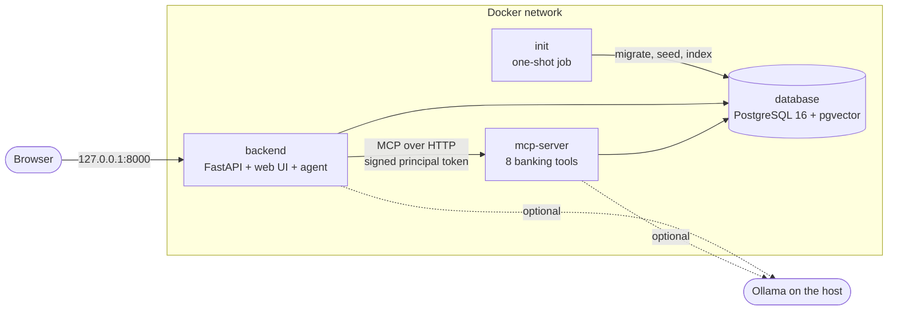

# Running BankAI with Docker

The whole system - database, MCP tool server and the API with its web UI - starts with one
command. Everything works with **MOCK** data only. This is a local prototype setup, not a
production deployment (see *Limitations*).

## Quick start

```bash
docker compose up --build        # first build about a minute; later starts about 20 seconds
```

Then open **http://localhost:8000**, pick a MOCK customer and ask a question.

No `.env`, API key or LLM is needed. By default the stack runs **offline**: rule-based routing,
template answers and hashing embeddings.

| task | command |
|---|---|
| run in the background | `docker compose up --build -d --wait` |
| see what is running | `docker compose ps -a` |
| follow the logs (JSON) | `docker compose logs -f backend` |
| operator key for the evaluation dashboard | `docker compose exec backend cat /var/lib/bankai/secrets/operator_api_key` |
| stop (keep the data) | `docker compose down` |
| start from scratch (delete data and secrets) | `docker compose down -v` |
| a database shell | `docker compose exec database psql -U bankai` (or from the host: port 5433) |

## What runs



| service | what it does | reachable from the host |
|---|---|---|
| `database` | PostgreSQL 16 with pgvector: accounts, transactions, knowledge-base vectors, audit log, evaluation runs | `127.0.0.1:5433` (for psql and tests) |
| `init` | runs once per start and exits: secrets → `alembic upgrade head` → MOCK seed (only into an empty database) → knowledge-base index | - |
| `mcp-server` | the 8 tools over MCP (streamable HTTP); every call carries a signed customer token | **no** - internal only |
| `backend` | FastAPI: the API, the web UI and the LangGraph agent, which calls the tools on `mcp-server` | `127.0.0.1:8000` |

**Start-up order**: compose waits for each step instead of hoping the timing works out:

`database` healthy → `init` finished successfully → `mcp-server` healthy → `backend` healthy.

The `init` job is safe to run on every start. It keeps existing secrets, skips seeding when data
exists, and re-indexes the knowledge base only when the documents or the embedder changed.

## Modes: offline, local LLM, voice

Optional features are separate compose files, added with `-f`:

```bash
# Offline (default): no LLM, no models, works anywhere
docker compose up --build

# With a local LLM: Ollama runs on the host (ollama pull qwen2.5:3b nomic-embed-text)
docker compose -f docker-compose.yml -f docker-compose.ollama.yml up --build

# + speech: download the models once on the host (python -m scripts.download_voice_models)
docker compose -f docker-compose.yml -f docker-compose.ollama.yml -f docker-compose.voice.yml up --build
```

- **Ollama stays on the host.** Docker on a Mac cannot use the Apple GPU, so a model inside a
  container would run several times slower. The containers reach the host as
  `host.docker.internal` (`OLLAMA_URL` to change it). Switching modes re-indexes the knowledge
  base with the new embedder; each embedder has its own rows, so vector spaces never mix.
- **Voice** gives only the backend a larger image (`bankai:local-voice`, about 1 GB instead of
  about 580 MB) with Whisper and Piper. The ~600 MB of models are mounted read-only from `./models`,
  not copied into the image.

The containers ignore the LLM, database and voice settings in your `.env`, which are meant for
running the code on the host. A mode is chosen only by the add-on files, so the same command
always starts the same stack.

## Configuration

Compose reads these from `.env` or the shell. All are optional; the defaults are shown.

| variable | default | used for |
|---|---|---|
| `BACKEND_PORT` | `8000` | host port of the web UI and API |
| `POSTGRES_PORT` | `5433` | host port of the database (5432 is often taken by a local PostgreSQL) |
| `POSTGRES_USER` / `POSTGRES_DB` | `bankai` | database account and name |
| `POSTGRES_PASSWORD` | `bankai` | a local default for MOCK data on 127.0.0.1 - change it for anything else |
| `MCP_AUTH_SECRET`, `API_SESSION_SECRET`, `OPERATOR_API_KEY` | generated | see *Secrets* |
| `OLLAMA_URL` | `http://host.docker.internal:11434` | Ollama add-on |
| `LLM_MODEL` / `EMBEDDING_MODEL` | `qwen2.5:3b` / `nomic-embed-text` | Ollama add-on |
| `STT_MODEL` | `small` | voice add-on |
| `ENVIRONMENT`, `LOG_LEVEL` | `development`, `INFO` | application |

Every application setting is described in [`.env.example`](../.env.example). A test checks that each
one is documented there, and another that the compose files set only variables the application
really reads, so a typo like `MCP_ALLOWED_HOST` cannot be silently ignored.

## Secrets

Nothing secret is in the repository, the compose files or the image. On the first start,
`init` runs `scripts/generate_secrets.py`, which writes three random values into the `secrets`
volume:

- `mcp_auth_secret` signs the customer tokens the backend sends to the MCP server;
- `api_session_secret` signs the browser login sessions, so they survive restarts;
- `operator_api_key` opens the evaluation dashboard.

They are files with mode `0600`, owned by the unprivileged `bankai` user. The application reads
them through `SECRETS_DIR`, the Docker-secrets convention, supported by pydantic-settings. A value
you put in `.env` replaces the generated one; an empty `KEY=` means "not set". Values are never
printed or logged. `docker compose down -v` deletes them together with the data.

## Security of the containers

| measure | why |
|---|---|
| runs as user `bankai` (uid 10001), not root | a compromised process cannot change the system |
| read-only file system (`read_only: true`, `tmpfs: /tmp`) | nothing can be written into the image at run time |
| `cap_drop: [ALL]`, `no-new-privileges` | no Linux capabilities, no privilege escalation (setuid) |
| `mcp-server` has no published port | only containers on the compose network can call the tools |
| published ports bind to `127.0.0.1` | the demo is not exposed to the local network |
| `.dockerignore` is an allowlist | `.env`, `.git`, tests and models can never enter the build context |
| multi-stage build | the final image gets the installed packages and the application only; the build stage's download cache and requirement files stay behind |
| base image pinned to an exact version (`python:3.12.15-slim-bookworm`) | reproducible builds; same Python as the tests |
| health checks on every service | compose starts each service only when the ones it needs are healthy; `docker compose ps` shows the state (Compose does not restart an unhealthy container by itself - only one that exits) |
| JSON logs, rotated (`10m` × 3) | machine-readable, and the disk cannot fill up |

## Tests

- **`tests/unit/test_docker_config.py`** runs in every test run without Docker. It checks the
  rules above, the service wiring and start-up order, and that every compose variable is a
  real setting.
- **`tests/docker/test_compose_stack.py`** (marker `docker`) builds and starts the real stack
  under its own project name and free ports, then tests it from outside:
  - health, chat through the MCP server, and 403 for another customer;
  - the MCP port is closed and the containers run as uid 10001 on a read-only file system;
  - secrets are mode 0600, and an evaluation runs inside the container;
  - a second `init` run changes nothing.

  Afterwards it removes everything, volumes included. Run it with `pytest -m docker` (about 30
  seconds with a cached image). `REQUIRE_DOCKER=1` turns "skipped" into "failed" for CI.
- **Mutation testing** (`python -m scripts.mutation_test`) includes container mistakes: a root
  user, a published MCP port, a build context that is no longer an allowlist, a missing runtime
  dependency. The tests catch each one.
- The browser smoke test also runs against the containers:
  `node tests/frontend/ui_smoke.mjs http://localhost:8000 <operator key>`.

## What building the image found

1. **A missing runtime dependency.** The evaluation runner builds its frozen MOCK bank in an
   in-memory SQLite database, but `aiosqlite` was listed only in the development requirements.
   On a developer machine nothing failed, because dev packages were installed. In the image,
   "Run evaluation" would have crashed. It is now a runtime dependency, with a test.
2. **Noisy logs.** uvicorn adds a `color_message` field with terminal colour codes to its log
   records; it is now dropped from the JSON logs.

## Troubleshooting

| symptom | cause and fix |
|---|---|
| `ports are not available: ... 5432` or `8000` | the port is taken on the host: set `POSTGRES_PORT` / `BACKEND_PORT` in `.env` |
| `init` exits with an embedding error | the Ollama add-on is on but Ollama is not running on the host, or the model is missing: `ollama pull nomic-embed-text` |
| answers say "template" although the Ollama add-on is on | the LLM is unreachable; the agent falls back to templates by design (see `docker compose logs backend`) |
| the microphone button is disabled | the voice add-on is not on, or the browser is not on `localhost`/HTTPS |
| on Linux, `host.docker.internal` does not resolve | already handled by `extra_hosts: host-gateway` in the compose file |
| start completely fresh | `docker compose down -v`, then `docker compose up --build` |

## Limitations

- **One API worker.** Conversations and pending confirmations live in process memory, so the API
  cannot be scaled to several replicas as it is. A shared store (Redis, a PostgreSQL checkpointer)
  is the next step.
- **No TLS.** The demo listens on localhost only. A real deployment would sit behind a TLS proxy.
- **The default database password** is a known value. It is acceptable for MOCK data on
  127.0.0.1 and nothing else.
- **Image signing, vulnerability scanning and digest pinning** belong in the CI pipeline (phase 12).
